# Screenshots

Current app screens and generated scenery, captured from the application with a simulated
trainer and sample ride history. Open an image for its full size. The phone-remote browser
screens remain in the [remote guide](https://github.com/ORQWA/ORQWA/wiki/Devices-and-riding#remote).

## Riding and training

| Riding | Training |
|---|---|
|  |  |
|  |  |
|  |  |
|  |  |
|  | |

Video footage: “Le petit Menglonnais” by [Fred Van Gestel](https://cycling.vangestel.online/indoor/videos/france/le-petit-menglonnais/),
[CC BY-NC-SA 4.0](https://creativecommons.org/licenses/by-nc-sa/4.0/). That screenshot has the
same licence; the footage is used only in documentation.

## Courses, setup and analysis

| Before riding | After riding |
|---|---|
| |  |
|  |  |
|  |  |
|  |  |
|  |  |
|  |  |
|  |  |

## Cities and woodland

The same woodland view on Low and Ultra graphics.
Change quality in [Settings](https://github.com/ORQWA/ORQWA/wiki/Settings#graphics-and-full-screen).

| Low | Ultra |
|---|---|
|  |  |

| City streets | Woodland |
|---|---|
|  |  |
|  |  |
| 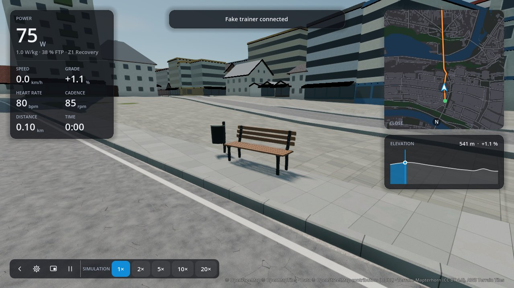 |  |

| Curved corners on Bielersee: Obedüre | Curbs from road height |
|---|---|
|  |  |

## Rocks and cliffs

| Cliff overview | Closer rock faces |
|---|---|
|  |  |

Repeat with `VIEWS="rock-cliff-overview rock-cliff-close"` in `scripts/render-views.sh`.
See the [boulder gallery](../art/README.md#vegetation).

## Standard route views

### Andermatt sidewalks

Generators 27–33 give sidewalk copies one owner using the local mapped section matched to
the ride. Coarse GPX bends no longer leave duplicate footways or phantom clearance cuts;
independent nearby streets and unridden parallel arms of the same map feature remain.
Walking tops follow their owning street's height and grade instead of draping down a bank
cut by another road. Closed sides reach terrain, and entrances and furniture share the
walking profile.
Road-width changes taper continuously. Partial building overlaps remove only the occupied
area, and rounding a bend no longer uses a replacement area large enough to cut the
sidewalk of the neighbouring street.
Curved joins share the adjoining straight walking surfaces' grades across the whole width;
matching footprints no longer conceal a height step at the tangent cross-section.
Overlapping walking pieces share one surface and grade. Continuous mapped streets keep
their own bend geometry rather than receiving another junction fan inside their loops;
narrow service arms cannot create isolated corner tiles without walking approaches.
Side walls close only the exposed walking perimeter; internal clipping seams no longer
extrude through the tread. Repeated boolean-cut vertices cannot duplicate paving.
Inferred raised sidewalks now require at least 12 m of connected walking length after
clipping. Short corner remnants disappear; small construction sections that join into a
long walk qualify together, including around bends and across terrain chunks.

These matching overview cameras use the full saved Alpenbrevet Gold inputs at
209.36 km to go (about 1.38 km from the start), near Andermatt. Nearby geometry alone is
sent to the renderer; the complete route determines terrain shaping and projection.
Buildings use their generated shells for context; vegetation is omitted.
Generic regression fixtures vary road width, loop direction and terrain-chunk placement;
they check coverage, walking height on both sides of internal joins and exposed side walls.
The fixed village, lakeside junction, city-bench and Oberalp hairpin/tunnel views below were
also regenerated and reviewed with the correction.
The village, junction, city-bench and Oberalp hairpin views were refreshed again for the
minimum-length rule; the long city walk and its bench/bin placement remain intact.

| Before | Continuous sidewalk at street height |
|---|---|
| 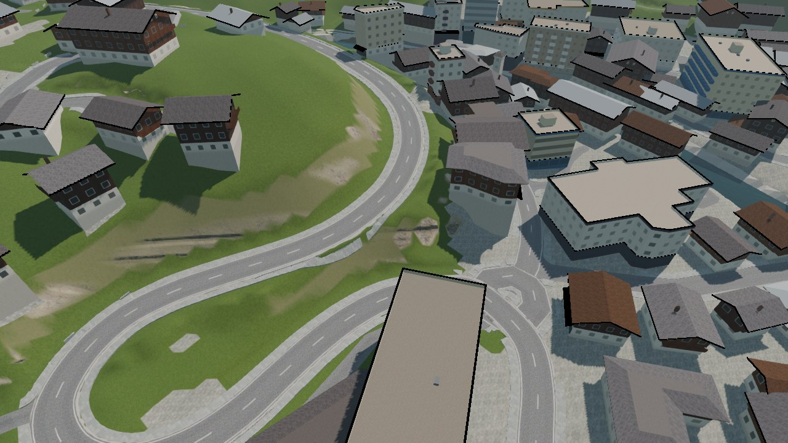 | 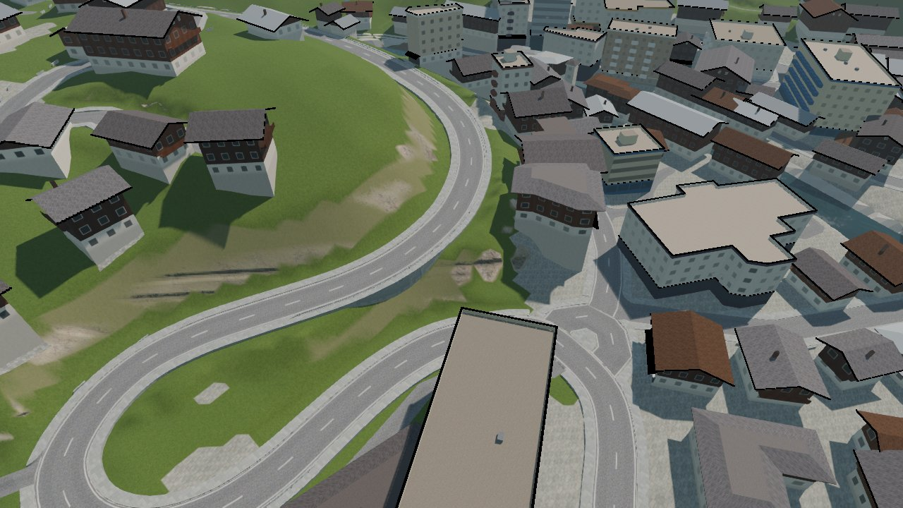 |
| 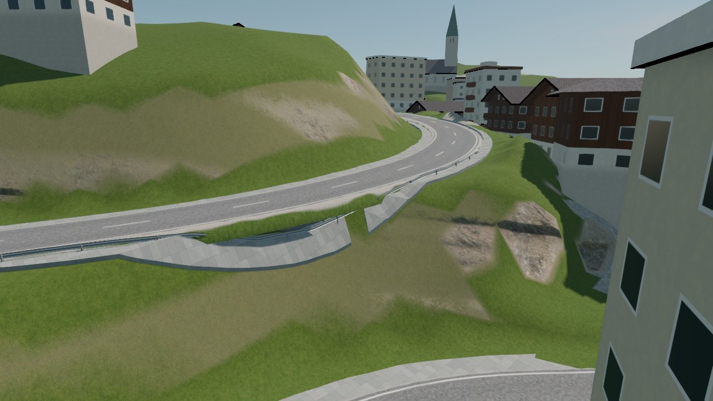 | 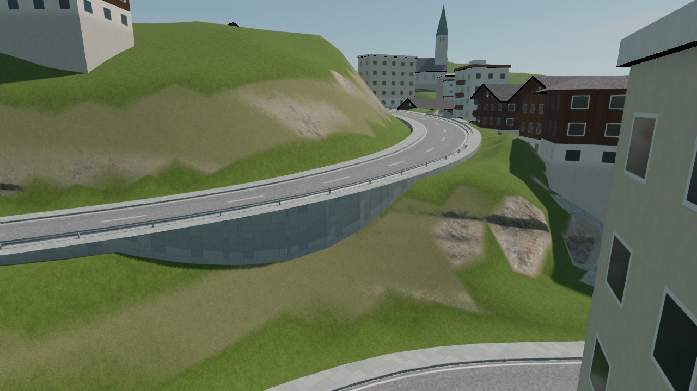 |
|  | 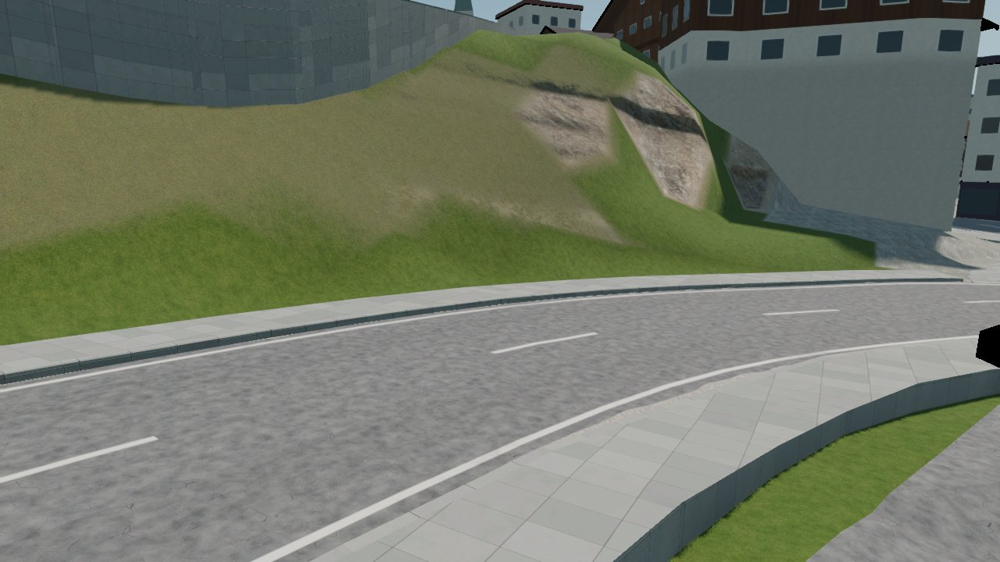 |
| 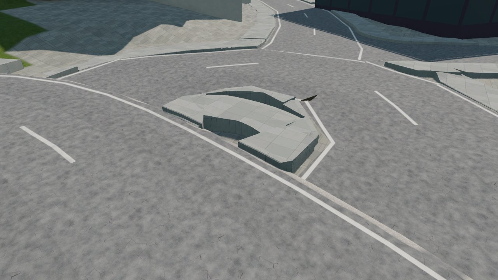 | 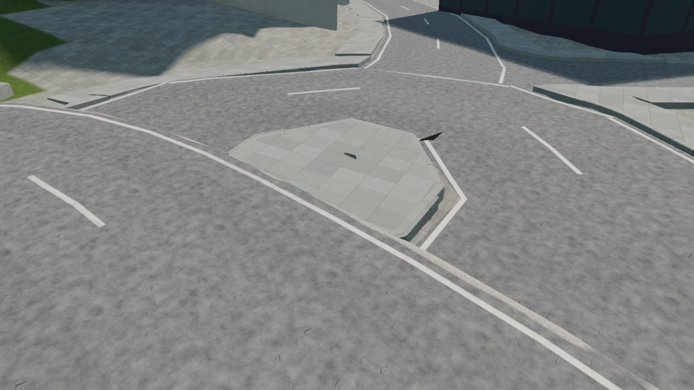 |

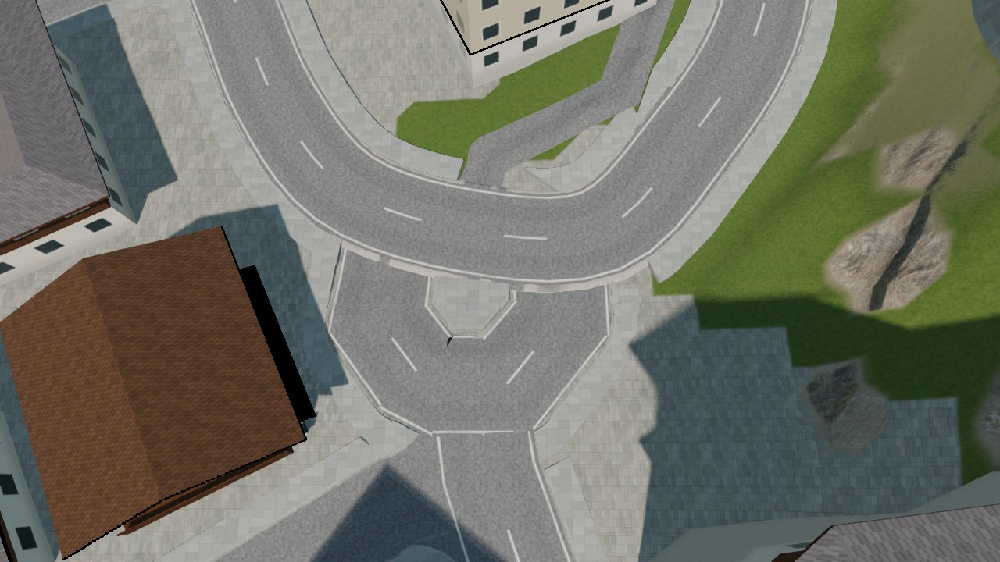

The following matching cameras use the same complete saved course at **116.93 km to go**
(93.81 km from the start). The short raised stubs beside the street are removed, while the
long sidewalk and separate building-front paving remain. Buildings use generated shells;
vegetation is omitted as in the Andermatt views above.

| Short sidewalk fragments | Minimum connected walking length |
|---|---|
|  | 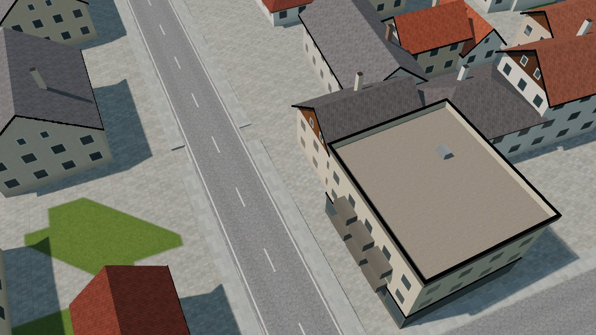 |

### Bridge ownership

The Alpenbrevet Lukmanier approach (approximately 34.8 km into the saved course) exposed a
second mapped bridge beneath the bridge ridden. Generator 13 gives the aligned bridge one
owner even when GPX smoothing shifts its centre line slightly; separate bridges remain.

| Duplicate mapped structure | One bridge |
|---|---|
|  |  |

The separate tunnel-to-bridge case is at **174.17 km to go**, approximately 36.57 km into
the full course. Generator 15 owns the complete aligned bridge despite the slight difference
between its mapped and resampled tag boundaries. Focused geometry renders below use the same
camera above and beside the transition, with vegetation and buildings omitted.

| Extra approach deck | Continuous approach |
|---|---|
|  |  |

### Railway approaches

Alpenbrevet Gold at 102.99 and 98.74 km to go (107.75 and 112.00 km into the full course).
Generator 17 keeps one clearance across the whole crossing instead of forcing adjacent
bridge and ground samples to incompatible heights. Independently elevated tracks also stop
copying the heights of nearby tracks at another level. These focused geometry comparisons
share cameras, saved course inputs and application materials, with vegetation/buildings omitted.

| Abrupt ramp | Gentle bridge approach |
|---|---|
|  |  |
|  |  |

### Support foundations

Generator 16 grounds piers and bearing walls on the completed terrain triangles across the
whole footing. The controlled Rust-generated regression contains a narrow DEM ridge absent
from the drawn grid; the old pier stopped 47.5 m above its visible ground. Cameras, terrain
and application materials are identical in the comparison.

| Floating pier | Foundation meets drawn ground |
|---|---|
|  |  |

The full saved Alpenbrevet course was also checked at the Furka bridge near 24.37 km to go
(186.37 km from the start), including bearing walls at its ends. This focused geometry view
omits vegetation and buildings:

### Tunnel approaches

Alpenbrevet Gold's Lukmanier approach at 34.97 km and the reverse view at 36.38 km.
These focused renders use the full saved course inputs, generated terrain and road meshes,
and the app's materials; vegetation and buildings are omitted to expose the obstruction.
Generator 14 cuts approach paving, rounded ends and junctions to the portal opening as well
as cutting the terrain. Cameras and projection remain identical in each pair.

| Approach before | Approach after |
|---|---|
|  |  |
|  |  |

### Local traffic lanes

The rider follows the local traffic side and the drawn carriageway width (R120), including
on narrow cycleways. Ghosts stay toward the centre on the same side. The map and recorded
route retain their original centre line.

| Right-hand traffic: Oberalp | Left-hand traffic: narrow London road |
|---|---|
|  |  |

[Tunnel before the fix](images/traffic/right-tunnel-before.jpg) ·
[London street](images/traffic/left-street.jpg) ·
[First person](images/traffic/left-first-person.jpg) ·
[Drone](images/traffic/left-drone.jpg)

Reproduce the London views in the dev container with
`GPX=core/fixtures/london-cycleway.gpx SHOTS="london-left-chase:120:0 london-left-first-person:120:1 london-left-drone:120:2 london-left-narrow:600:0" scripts/render-views.sh`.
The Swiss comparisons use `VIEWS="village-chase hairpin-chase oberalp-tunnel-chase oberalp-hairpins-drone"`.
The London review checks an offset of 1.5 m on the drawn 6 m carriageway at 120 m and
0.875 m on the drawn 3.5 m carriageway at 600 m; both offsets are left of travel.

### Guardrails beside lower hairpin arms

Generator 26 fits guardrail endpoint heights to their owning carriageway, retaining the
existing lateral clearance. Buried post feet meet the road edge/skirt; the lower bank no
longer dictates blade height. Curved spans and chunk joins share their fitted endpoints.

This matching close camera uses the saved Alpenbrevet Gold route at 30.64 km to go.
Generator 25 has already removed the duplicate asphalt in both images, making the remaining
low guardrail visible separately. After generator 26 the blade follows the upper wearing
surface and the lower road remains clear. Vegetation and buildings are omitted.

| Before | After |
|---|---|
|  |  |

### Duplicate terrain-draped streets

Generator 25 gives a close, aligned mapped copy of the ridden carriageway the same pavement
owner, using the original map feature matched for road appearance. Small GPX/map offsets
no longer leave duplicate asphalt, edge paint or lane markings on the bank below it.
Shallow joining roads, crossings and independent parallel ways retain their pavement.

These identical cameras use the full saved Alpenbrevet Gold inputs at 30.64 km to go
(180.10 km from the start), looking at the upper switchback beside the rider. Buildings and
vegetation are omitted. Within 150 m of that position, the duplicate mapped paving falls
from 3,608 triangles to zero; this includes 118 asphalt faces steeper than 45 degrees.
The second pair isolates a two-metre map/GPX offset on a steep bank: the extra strip and
its painted edge disappear while the ridden road remains.

| Before | After |
|---|---|
|  |  |
|  |  |

### General road clearance for bridge and roadside fences

Generator 24 checks complete barrier footprints against the actual generated carriageways
and junction fills. Rails, posts, kerbs and parapets cannot cut a road even at a parallel
join or between clear span endpoints. Low slab edges also recede below joining pavement,
keeping their closed sides and undersides. Independent higher bridges retain protection.
Roadside guardrail and fence models use the same clearance rule.

The actual Alpenbrevet start/finish junction is shown around 0.33 km from the start
(210.41 km to go). Generator 23 had removed the duplicate return bridge, but a single fence
still followed the GPX across the joining carriageway. These matching close cameras show
the general clearance correction. Buildings and vegetation are omitted.
The second pair is an independent mapped bridge with a parallel road joining one side,
using no roundabout detection or course-specific conditions.

| Before | After |
|---|---|
|  |  |
|  |  |

### Protection through curves

Generator 22 fits each guardrail span between shared road-edge endpoints rather than placing
straight models on centre-line tangents. Bridge sections and post directions follow the
wearing surface's curve. The controlled 12 m hairpin shows both the inside overlaps and
outside gaps; the actual Alpenbrevet start/finish loop checks the curved bridge beside its
roundabout, around 0.33 km from the start (210.41 km to go). Matched cameras use the real
materials and prop instances; buildings and vegetation are omitted.

| Before | After |
|---|---|
|  |  |
|  |  |

### Roadside protection beside a lower railway

Alpenbrevet Gold at 33.52 km to go (177.22 km from the start), using full saved inputs and
the actual guardrail and post instances. Generator 21 preserves the road's verge datum
beside the lower railway, so its protection meets the ground at carriageway height.
Buildings and vegetation are omitted; the cameras are identical.

| Before | After |
|---|---|
|  |  |

### Tunnel interior and roof

Full saved Alpenbrevet Gold inputs around 175.72 km to go (35.02 km from the start), using
identical cameras before and after generator 20. The complete tube is now clear of terrain,
including thin strips at floor level, and the mapped approach no longer paints its roof.
These focused geometry views omit vegetation and buildings.

| View | Before | After |
|---|---|---|
| Inside |  |  |
| Approach |  |  |

### Duplicate bridge decks on ground-tagged course sections

Full saved Alpenbrevet Gold inputs, with identical cameras before and after generator 19.
The village bridge is near 32.05 km from the start; the rider's 178.51 km-to-go screenshot
looks back toward it. The other comparisons cover the 68.85 and 67.26 km-to-go reports.
These focused geometry views omit vegetation and buildings.

| Location | Before | After |
|---|---|---|
| Village |  |  |
| 68.85 km to go |  |  |
| 67.26 km to go |  |  |

### Bridge junctions

Controlled offline world-generator fixture: a mapped bridge with terrain endpoints 1.5 m
above the ridden road. Its connected end now meets the road without a step or railing
across it; the approach bank follows the deck. Separate overpasses keep their protection.

| Before | After |
|---|---|
|  |  |

### Road profiles

Road hierarchy and paving (R119, [ADR 0031](adr/0031-road-appearance.md)) use the same
materials for ridden and surrounding ways. This controlled, offline scene uses the Rust
world generator; widths and lane counts are illustrative estimates, not a mapped location:

In the dev container, reproduce it with
`cargo test --manifest-path core/Cargo.toml -p orqwa-world road_profiles_render_fixture -- --ignored`,
then `OUT=/workspaces/orqwa/screenshots/road-profiles.png xvfb-run -a godot --path app --resolution 1600x1000 -s res://tools/render_roads.gd`.

The sample course's shallow junctions near Lamboing retain their joining segments and open
the shoulder at the road edge:

Reproduce with `COURSE=core/orqwa-gd/courses/twann-chasseral.tqc`
and `SHOTS="lamboing:4200:2:0,180,-20"` in `scripts/render-views.sh`. The course uses its
saved inputs offline. Matching before/after review images are in `docs/images/roads/`.

The Oberalp railway bridge (R122), seen from the same riding camera before and after the
proportion and material changes. The close views check open railings, supports and the soffit.

| Before: broad deck with solid walls | After: narrower deck and open railings |
|---|---|
|  |  |

| Approach | From below |
|---|---|
|  |  |

The non-ridden bridge regression scene checks the deck from underneath and above (R121).
It uses generated test geometry with the application's road, street and terrain materials.

| Before: sky visible through the deck | After: solid underside |
|---|---|
|  |  |

The [river geometry correction](adr/0030-river-levels.md) is checked against the
Alpenbrevet Gold course near 104.57 km remaining and farther upstream:

The fixture routes exercise villages, climbs, junctions, bridges, tunnels and weather. Their
fixed camera positions make it possible to compare future changes. These are the current
renders; historical before/after images remain with their original reviews.

| Villages and roads | Lake and junction views |
|---|---|
| 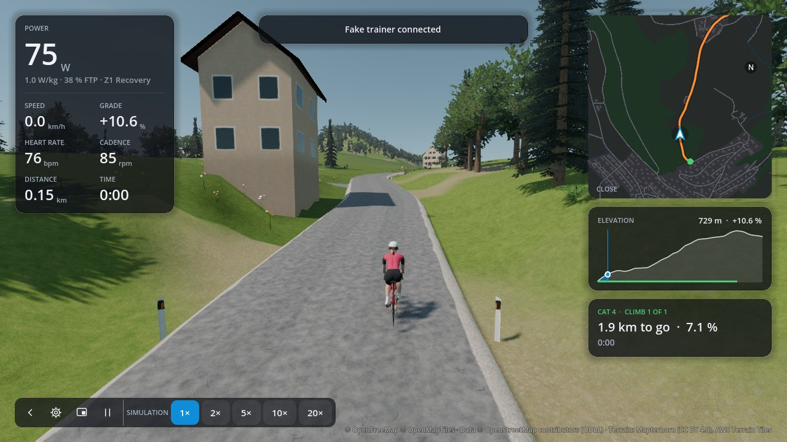 |  |
|  |  |
|  |  |
|  |  |
|  |  |
|  |  |
|  | 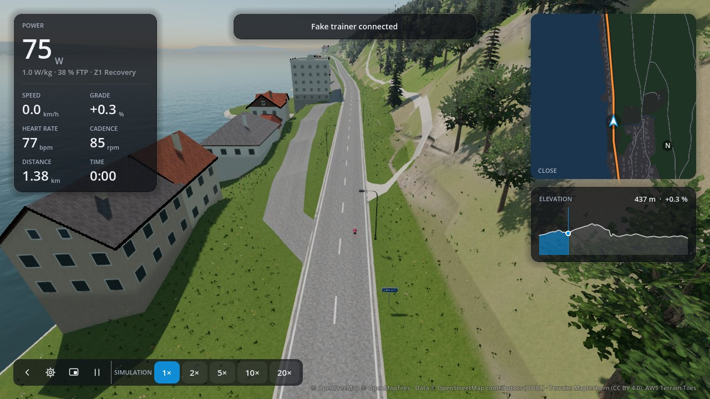 |
|  | |

| Bern | Oberalp |
|---|---|
|  | 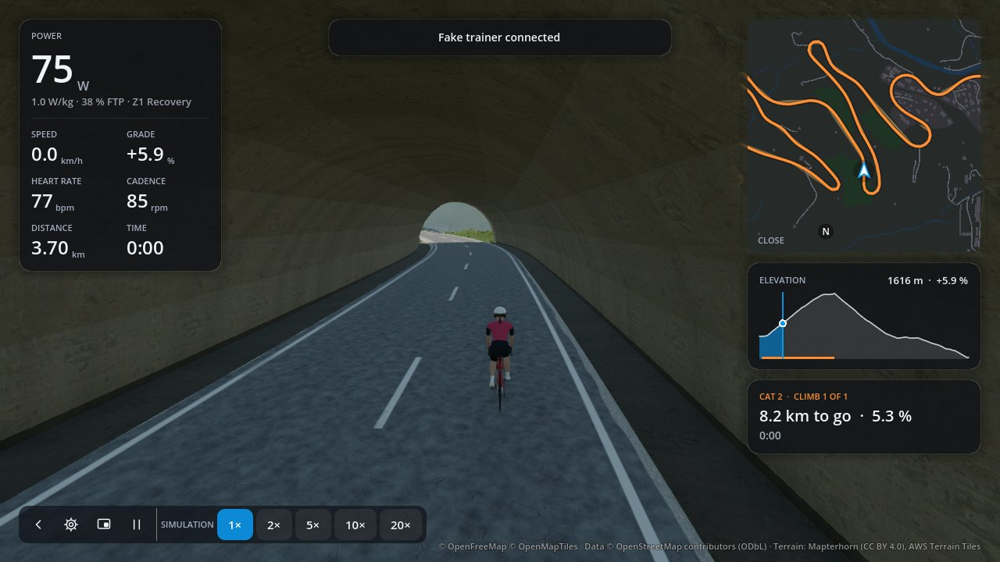 |
|  |  |
|  | 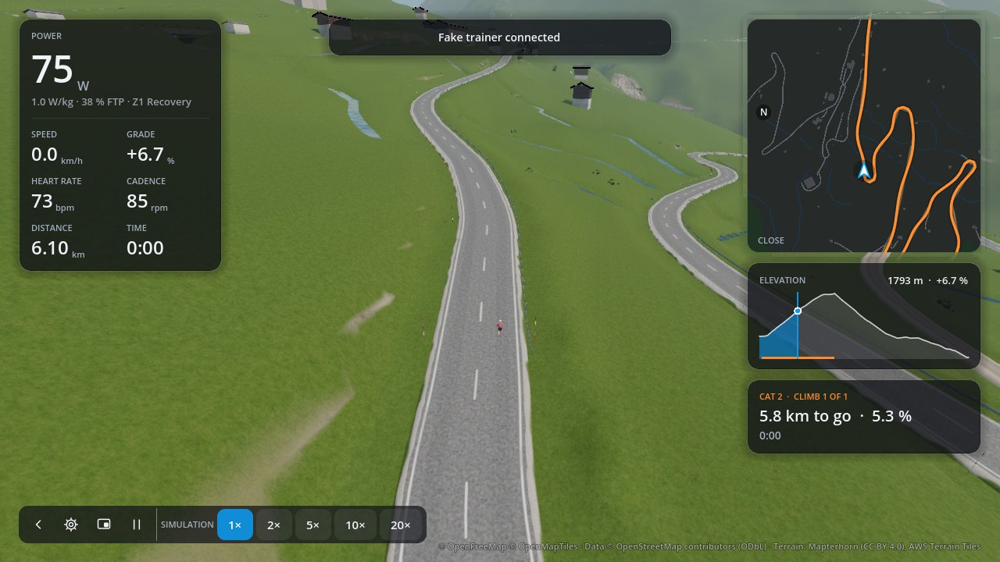 |
|  |  |
|  |  |
| |  |

Every building, plant, roadside prop and rider also has a refreshed image in the
[model galleries](../art/README.md#gallery). See [Development](development.md#refreshing-screenshots)
for the capture and review workflow.
